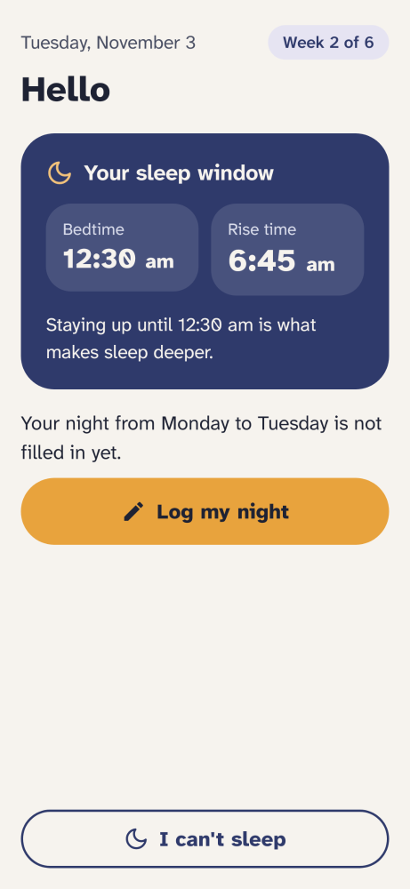
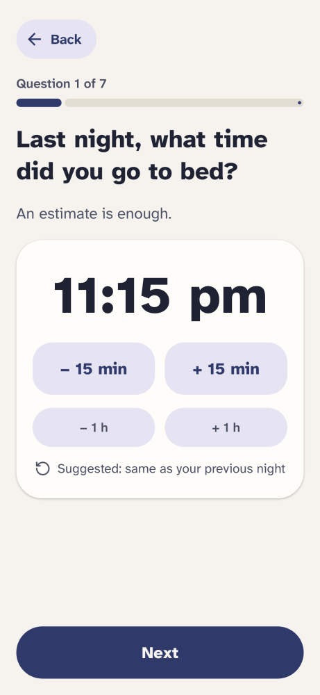
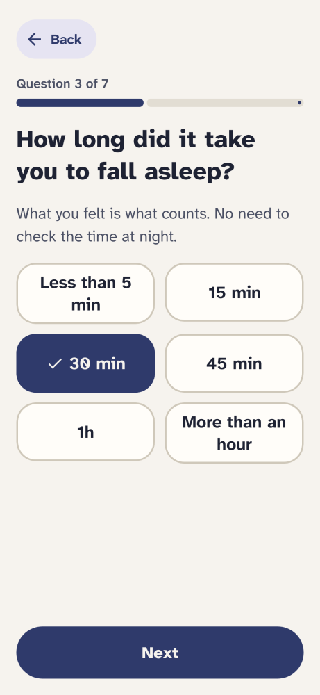
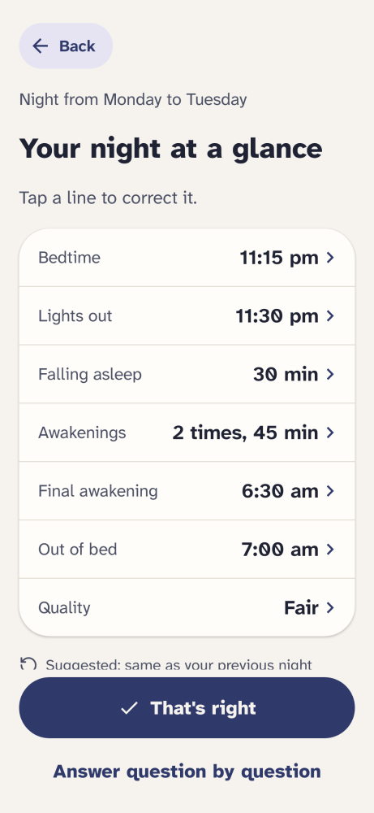
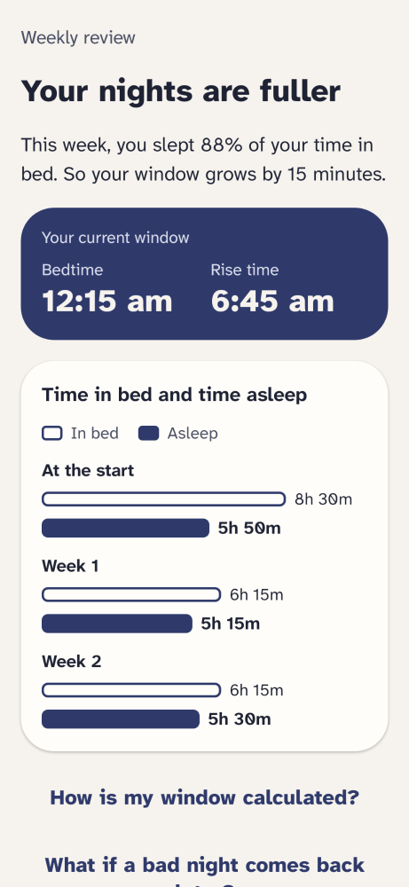
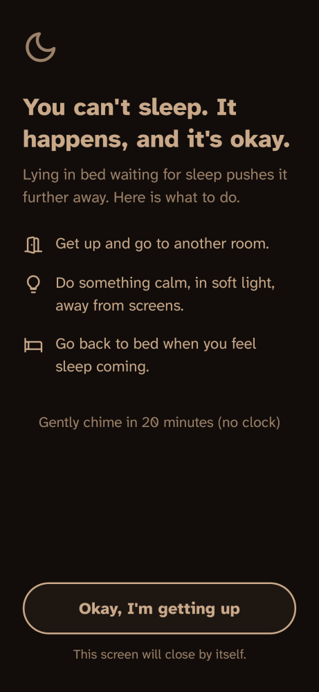
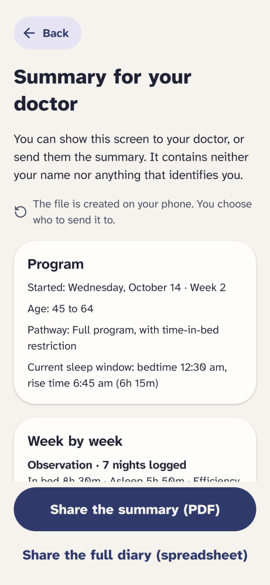
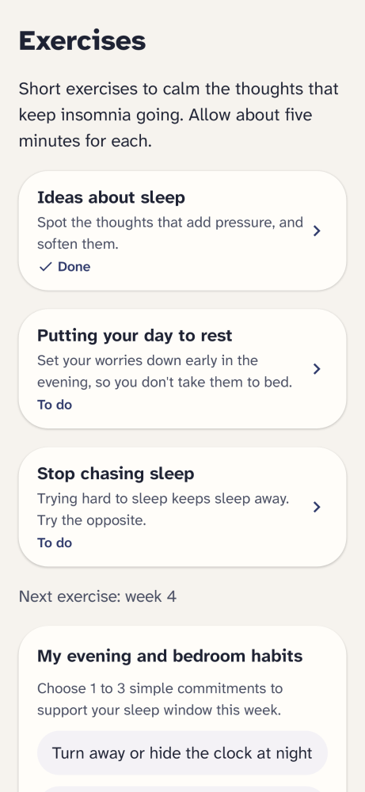
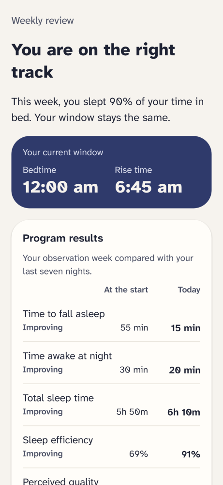

# Sommelle

[Français](README.md) · **English**

[](https://github.com/Relthdrarxash/sommelle/actions/workflows/ci.yml)

An Android app that supports people with insomnia, based on CBT-I (cognitive behavioral therapy for insomnia), the first-line treatment recommended by European and American guidelines. Free, in English and French, no account and no ads. No data leaves the phone.

Sommelle is a self-help and education tool. It is not a medical device and does not replace medical advice.

**[Sommelle website](https://relthdrarxash.github.io/sommelle/en/)** · **[Google Play](https://play.google.com/store/apps/details?id=fr.sommelle)** · **[Download APK](https://github.com/Relthdrarxash/sommelle/releases/latest)** · [For health professionals](https://relthdrarxash.github.io/sommelle/en/professionals.html) · [Scientific dossier](https://relthdrarxash.github.io/sommelle/en/protocol.html) · [Privacy](https://relthdrarxash.github.io/sommelle/en/privacy.html)

## What the app does

Over six to eight weeks:

- **An entry questionnaire and clear 6-week roadmap** rule out sleep restriction when it is not advised (possible apnea, bipolar disorder, epilepsy, pregnancy, safety-critical job), explain the three stages of the program upfront, and point to a doctor when needed.
- **A sleep diary** is filled in each morning in about twenty seconds, without a keyboard, with reassuring guidance during the first week of sleep restriction.
- **A sleep window** (bedtime and rise time) is calculated after an observation week, then adjusted each week based on your nights, with personalized evening landmarks (quiet wind-down 1h before bed, last caffeine 8h before bed).
- **A night screen**, almost black and clock-free, reminds you what to do when sleep does not come and offers an optional **20-minute gentle chime** (stimulus control rule without a visible countdown).
- **Five cognitive exercises and evening habit commitments** unlock over the program: ideas about sleep, putting the day to rest (with an interactive evening notepad on the phone), paradoxical intention, decatastrophizing, relaxation, each playable **with your eyes closed** via a calm offline voice guide and gentle acoustic chime, alongside 5 checkable bedroom and evening habits.
- **A before/after review and relapse-prevention guide** compare the observation week with the latest nights and explain what to do if an occasional bad night comes back later.
- **A summary for the doctor**, to show on screen or share as a PDF and a spreadsheet, plus **CSV backup import** in settings.
- Optional **reminders** in the morning and evening, and a **discreet home screen widget** showing the evening sleep window.

## Preview

<table>
  <tr>
    <td align="center"><br>Home</td>
    <td align="center"><br>Guided diary</td>
    <td align="center"><br>Estimates</td>
  </tr>
  <tr>
    <td align="center"><br>Diary summary</td>
    <td align="center"><br>Weekly review</td>
    <td align="center"><br>I can't sleep</td>
  </tr>
  <tr>
    <td align="center"><br>Summary for the doctor</td>
    <td align="center"><br>Exercises</td>
    <td align="center"><br>Before/after review</td>
  </tr>
</table>

Screenshots are generated from the screen code on every change.

## Design commitments

- **No morning score out of 100**: a hard night is information used to adjust your weekly schedule, not a failure to grade.
- **No clock or countdown at night**: checking the time at 3 AM keeps you awake. The night screen hides the status bar clock and offers a gentle 20-minute chime with no numbers on screen.
- **No Internet permission or subscription**: the full 6-to-8-week program works offline and for free.

## From the same studio (Pilmil Studio)

- **[Lunaison](https://github.com/Relthdrarxash/lunaison)**: free, open-source offline menstrual cycle tracker with referenced medical guides and serverless partner sharing.
- **[Respire](https://github.com/Relthdrarxash/respire)**: a short breathing pause before the apps you open on autopilot, especially helpful in the evening before bed.
- **[Sauve](https://github.com/Relthdrarxash/sauve)**: anti-panic first aid guide, free, open source and offline, with hands-free voice and haptic guidance.
- **[Sillon](https://github.com/Relthdrarxash/sillon)**: living vegetable garden planner and agronomic calendar based on the last frost date, free, open source and offline.

## Why Sommelle is free

Cognitive behavioral therapy for insomnia (CBT-I) is the recommended first-line treatment, but it remains hard to access: few trained practitioners, long waits, and a cost often paid by the patient. Sommelle aims to help as many people as possible, because everyone deserves help to sleep better. The app is free, open source and collects no data. It does not replace a doctor, but it lets you get started.

## Principles

- **Based on guidelines.** Consensus Sleep Diary, sleep restriction and stimulus control following European (2023) and American (2021) guidelines. The rules, thresholds and sources are described in the [scientific dossier](https://relthdrarxash.github.io/sommelle/en/protocol.html), with their limitations.
- **100% local.** No account, no server, no Internet permission, no trackers. Since the code is public, anyone can check.
- **For everyone.** Designed for someone who is half awake, including older people or those less comfortable with technology: big buttons, no jargon, no hidden gestures, Atkinson Hyperlegible font, warm night theme. The choices are explained in the [interface principles](documentation/design.md) (in French).
- **No guilt.** No daily score, no streak to keep up, no red.
- **Only what is needed in the app, the explanations on the website.** The app sticks to what is needed to follow the program. The reason for each step, and what comes from a study versus a design choice, is on the [Why Sommelle works the way it does](https://relthdrarxash.github.io/sommelle/en/why.html) page.

## Languages

The app follows the phone's language: French on a phone set to French, English otherwise. Interface texts are Android resources (`values/` in English, `values-fr/` in French); times, durations and labels built from data come from `TextFormat` in `:core:presentation` (`FrenchFormat`, `EnglishFormat`).

## Building

Open the project in Android Studio, or from the command line:

```bash
./gradlew test                 # tests for the engine and screen logic
./gradlew :app:assembleDebug   # development build
```

The development APK for each change can also be downloaded from the Actions tab.

## Contact

Questions, feedback, comments from health professionals: [pilmil.studio@proton.me](mailto:pilmil.studio@proton.me).

## If you are in distress

If you are going through a hard time, call your local emergency number or a crisis line in your country, such as 988 in the United States. In France, 3114 (the national suicide prevention line) is free, 24/7.

## License

Sommelle is distributed under the [Mozilla Public License 2.0](LICENSE) (MPL-2.0): you can use, study, modify and redistribute it; files you modify must stay under the same license, with their source code.

## A note on development

Sommelle's code was developed with the help of an AI assistant (Claude, by Anthropic): the app itself embeds no artificial intelligence, all content and calculations rely on the clinical CBT-I protocol (HAS, Réseau Morphée, ESRS, CBT-i Coach), the program engine and screen logic are deterministic and covered by automated tests, and I personally maintain the project and answer issues and messages myself.
