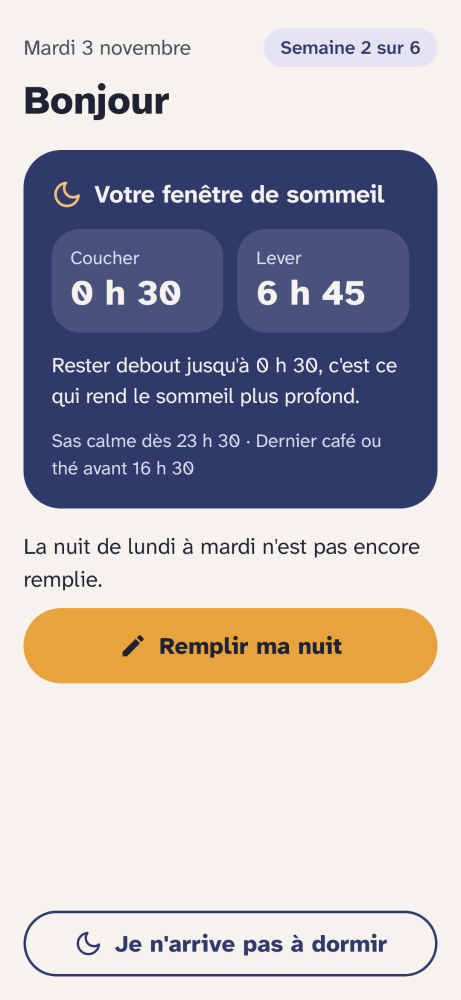
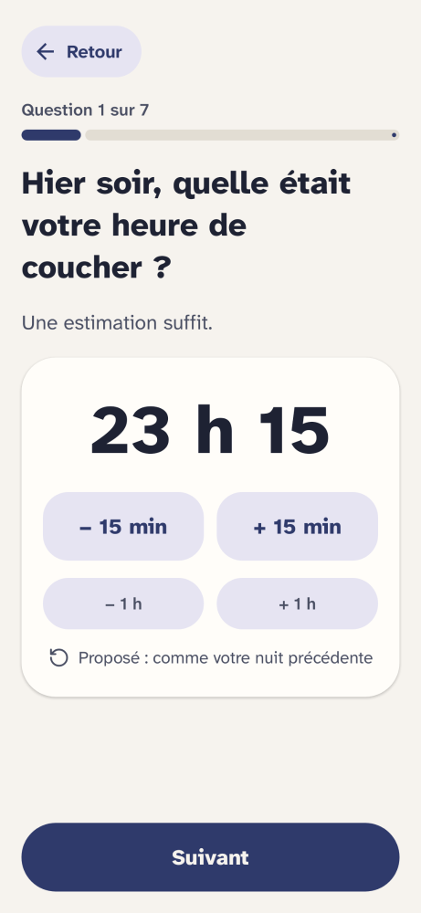
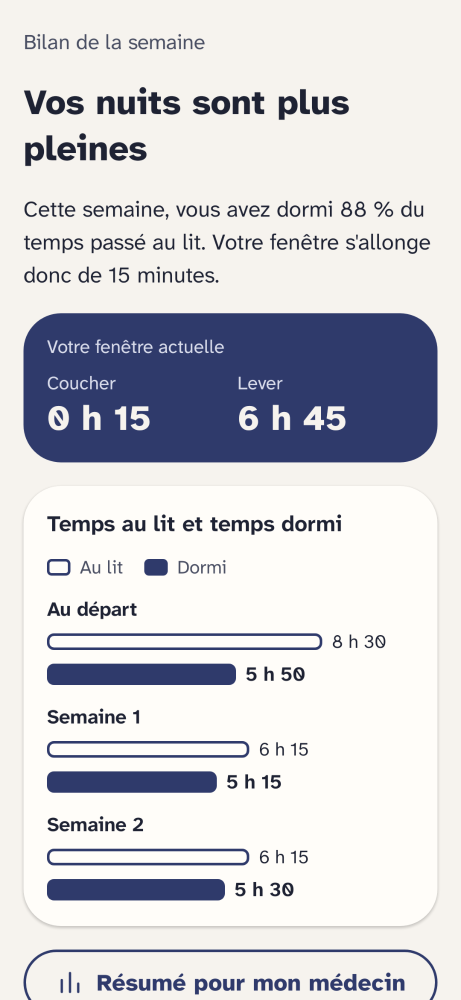
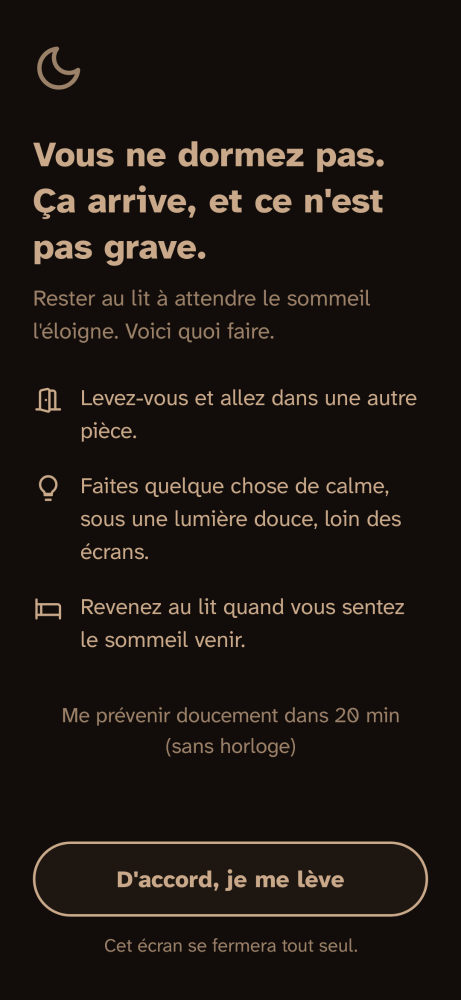
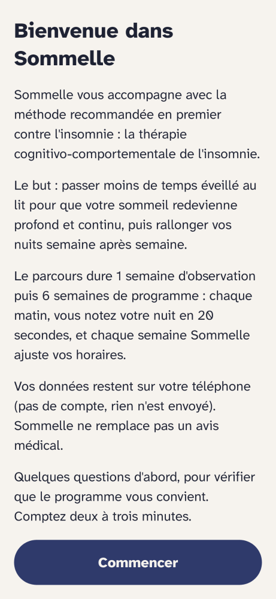
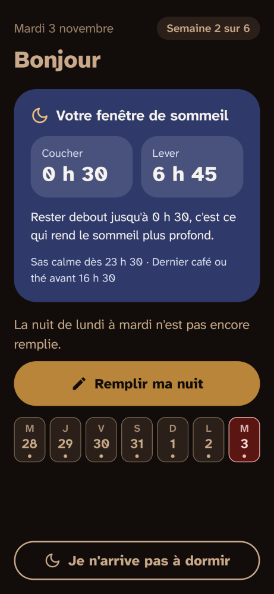
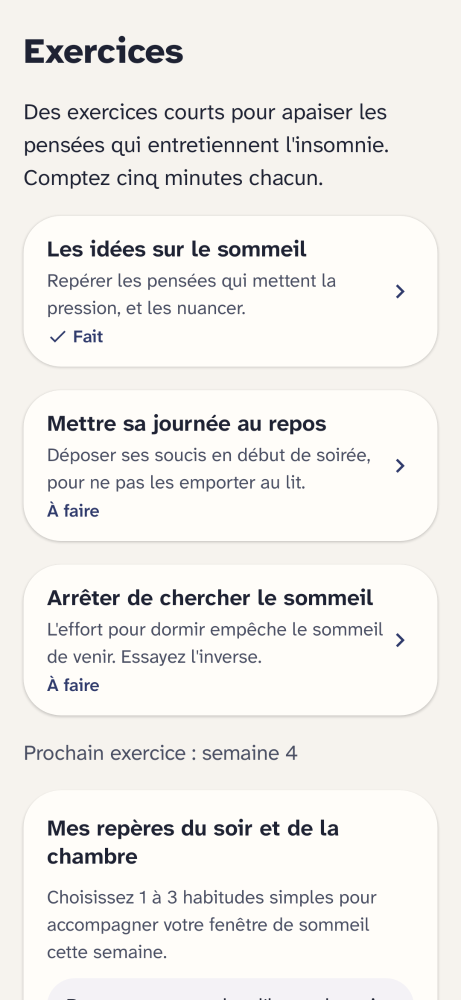

# Sommelle

**Français** · [English](README.en.md)

[](https://github.com/Relthdrarxash/sommelle/actions/workflows/ci.yml)

Application Android d'accompagnement à l'insomnie fondée sur la TCC-I (thérapie cognitivo-comportementale de l'insomnie), le traitement recommandé en premier par les recommandations européennes et américaines. Gratuite, en français et en anglais, sans compte et sans publicité. Aucune donnée ne quitte le téléphone.

Sommelle est un outil d'accompagnement et d'éducation. Ce n'est pas un dispositif médical et elle ne remplace pas un avis médical.

**[Site de Sommelle](https://relthdrarxash.github.io/sommelle/)** · **[Google Play](https://play.google.com/store/apps/details?id=fr.sommelle)** · **[Télécharger l'APK](https://github.com/Relthdrarxash/sommelle/releases/latest)** · [Pour les professionnels de santé](https://relthdrarxash.github.io/sommelle/professionnels.html) · [Dossier scientifique](https://relthdrarxash.github.io/sommelle/protocole.html) · [Confidentialité](https://relthdrarxash.github.io/sommelle/confidentialite.html)

## Ce que fait l'appli

Pendant six à huit semaines :

- **Un questionnaire d'entrée et un repère clair sur la durée (6 semaines)** écartent la restriction du sommeil quand elle est déconseillée (apnée possible, trouble bipolaire, épilepsie, grossesse, métier à risque), expliquent les trois étapes du programme dès le départ et orientent vers un médecin si besoin.
- **Un agenda du sommeil** se remplit chaque matin en une vingtaine de secondes, sans clavier, avec un accompagnement rassurant pendant la première semaine de restriction.
- **Une fenêtre de sommeil** (heures de coucher et de lever) est calculée après une semaine d'observation, puis ajustée chaque semaine selon les nuits, avec des repères horaires adaptés (sas calme 1 h avant, arrêt de la caféine 8 h avant).
- **Un écran pour la nuit**, presque noir et sans horloge, rappelle quoi faire quand le sommeil ne vient pas et propose un **repère sonore doux à 20 minutes** (règle du contrôle du stimulus, sans afficher de décompte).
- **Cinq exercices cognitifs et une liste d'engagements du soir** se débloquent au fil du programme : idées sur le sommeil, mise au repos de la journée (avec un carnet du soir interactif sur le téléphone), intention paradoxale, décatastrophisation, relaxation — chacun pouvant être écouté **les yeux fermés** grâce à une lecture vocale hors ligne à débit apaisé et une cloche acoustique douce — complétés par 5 habitudes cochables de chambre et de soirée.
- **Un bilan avant/après et un guide anti-rechute** comparent la semaine d'observation aux dernières nuits et rappellent la conduite à tenir si une mauvaise nuit isolée revient plus tard.
- **Un résumé pour le médecin**, à montrer à l'écran ou à partager en PDF et en tableur, ainsi qu'un **import de sauvegarde CSV** dans les réglages.
- **Des rappels** optionnels le matin et le soir, et un **widget discret sur l'écran d'accueil** affichant la fenêtre de sommeil du soir.

## Aperçu

<table>
  <tr>
    <td align="center"><br>Accueil</td>
    <td align="center"><br>Agenda guidé</td>
    <td align="center"><br>Estimations</td>
  </tr>
  <tr>
    <td align="center"><br>Agenda résumé</td>
    <td align="center"><br>Bilan de la semaine</td>
    <td align="center"><br>Je n'arrive pas à dormir</td>
  </tr>
  <tr>
    <td align="center"><br>Bienvenue</td>
    <td align="center"><br>Questionnaire</td>
    <td align="center"><br>Thème de nuit</td>
  </tr>
  <tr>
    <td align="center"><br>Résumé pour le médecin</td>
    <td align="center"><br>Exercices</td>
    <td align="center"><br>Bilan avant/après</td>
  </tr>
</table>

Les captures sont générées à partir du code des écrans à chaque modification.

## Parti pris

- **Pas de note sur 100 chaque matin** : une mauvaise nuit est une information pour ajuster vos horaires de la semaine, pas un échec à noter.
- **Pas d'horloge ni de décompte la nuit** : regarder l'heure à 3 h du matin entretient l'éveil. L'écran de nuit masque l'heure et propose un timbre doux à 20 minutes sans afficher de chiffre.
- **Pas de permission Internet ni d'abonnement** : l'ensemble du programme de 6 à 8 semaines fonctionne hors ligne et gratuitement.

## Du même atelier (Pilmil Studio)

- **[Lunaison](https://github.com/Relthdrarxash/lunaison)** : suivi du cycle menstruel libre, gratuit et sans accès à Internet, avec fiches médicales sourcées et partage partenaire hors-ligne.
- **[Respire](https://github.com/Relthdrarxash/respire)** : une courte pause de respiration avant les applications que l'on ouvre par réflexe, particulièrement utile le soir avant le coucher.

## Pourquoi Sommelle est gratuite

La thérapie cognitive et comportementale de l'insomnie (TCC-I) est le traitement recommandé en première intention, mais elle reste difficile d'accès : peu de praticiens formés, des délais longs, un coût souvent à la charge du patient. Sommelle veut aider le plus grand nombre de personnes possible, parce que tout le monde a droit à de l'aide pour mieux dormir. L'appli est gratuite, libre et ne collecte aucune donnée. Elle ne remplace pas un médecin, mais elle permet de commencer.

## Principes

- **Fondée sur les recommandations.** Agenda du Consensus Sleep Diary, restriction du temps au lit et contrôle du stimulus selon les recommandations européennes (2023) et américaines (2021). Les règles, seuils et sources sont décrits dans le [dossier scientifique](https://relthdrarxash.github.io/sommelle/protocole.html), avec leurs limites.
- **100 % locale.** Pas de compte, pas de serveur, pas de permission Internet, pas de traceur. Le code étant public, chacun peut le vérifier.
- **Pour tout le monde.** Conçue pour une personne mal réveillée, y compris âgée ou peu à l'aise avec le numérique : grands boutons, pas de jargon, pas de geste caché, police Atkinson Hyperlegible, thème de nuit chaud. Les choix sont expliqués dans les [principes d'interface](documentation/design.md).
- **Sans culpabilité.** Pas de score quotidien, pas de série à maintenir, pas de rouge.
- **L'appli au strict nécessaire, les explications sur le site.** L'appli se limite à ce qu'il faut pour suivre le programme. Le pourquoi de chaque étape, ce qui relève d'une étude et ce qui relève d'un choix de conception, est sur la page [Pourquoi Sommelle est faite comme ça](https://relthdrarxash.github.io/sommelle/pourquoi.html).

## Documentation

| Document | Contenu |
|---|---|
| [Pourquoi Sommelle est faite comme ça](https://relthdrarxash.github.io/sommelle/pourquoi.html) | Pour le grand public : chaque étape, sa raison, à quoi s'attendre les premières semaines, sources (source : `docs/pourquoi.html`) |
| [Dossier scientifique](https://relthdrarxash.github.io/sommelle/protocole.html) | Pour les soignants : composantes de TCC-I, calculs avec exemple, sécurité, exercices, limites, sources (source : `docs/protocole.html`) |
| [Principes d'interface](documentation/design.md) | Pour qui, et comment l'interface s'adapte à une personne fatiguée |
| [Architecture](documentation/architecture.md) | Modules, données, accessibilité |
| [Contribuer](CONTRIBUTING.md) | Compiler, tester, captures d'écran, site |

## Langues

L'appli suit la langue du téléphone : français sur un téléphone en français, anglais sinon. Les textes de l'interface sont des ressources Android (`values/` en anglais, `values-fr/` en français) ; les heures, durées et libellés composés à partir des données viennent de `TextFormat` dans `:core:presentation` (`FrenchFormat`, `EnglishFormat`).

## Compiler

Ouvrir le projet dans Android Studio, ou en ligne de commande :

```bash
./gradlew test                 # tests du moteur et de la logique d'écran
./gradlew :app:assembleDebug   # application de développement
```

L'APK de développement de chaque modification est aussi téléchargeable dans l'onglet Actions.

## Contact

Questions, retours d'utilisation, remarques de professionnels de santé : [pilmil.studio@proton.me](mailto:pilmil.studio@proton.me).

## En cas de détresse

Si vous traversez une période difficile, le 3114 (numéro national de prévention du suicide) est joignable gratuitement, 24 h/24 et 7 j/7.

## Licence

Sommelle est distribuée sous licence [GNU GPL v3.0](LICENSE). Vous pouvez l'utiliser, l'étudier, la modifier et la redistribuer, à condition que toute version redistribuée reste publiée sous la même licence, avec son code source.

Une [permission additionnelle](LICENSE-EXCEPTION.md) (article 7 de la GPL) autorise la distribution par les magasins d'applications, App Store compris, tant que le code source reste disponible sous la même licence.

## Note sur le développement

Le code de Sommelle a été développé avec l'aide d'un assistant IA (Claude, d'Anthropic) : l'application elle-même n'embarque aucune intelligence artificielle, tous les contenus et calculs reposent sur le protocole clinique de la TCC-I (HAS, Réseau Morphée, ESRS, CBT-i Coach), le moteur du programme et la logique des écrans sont déterministes et couverts par des tests automatiques, et je maintiens personnellement le projet en répondant moi-même aux tickets et aux messages.
